# Monkey Bridge

```text
   __  ___            __                  ____       _     __           
  /  |/  /___  ____  / /_____  __  __   / __ )_____(_)___/ /___ ____ 
 / /|_/ / __ \/ __ \/ //_/ _ \/ / / /  / __  / ___/ / __  / __ `/ _ \
/ /  / / /_/ / / / / ,< /  __/ /_/ /  / /_/ / /  / / /_/ / /_/ /  __/
/_/  /_/\____/_/ /_/_/|_|\___/\__, /  /_____/_/  /_/\__,_/\__, /\___/ 
                             /____/                      /____/       
```

> **🐵 Monkey Bridge** — A high-performance, stealth OpenAI-compatible REST API bridge powered by ChatGPT Web automation and Chrome DevTools Protocol (CDP) network interception.

---

## 📖 What is Monkey Bridge?

**Monkey Bridge** turns your standard **ChatGPT Web account (Free or Plus)** into a full-featured, drop-in replacement for the official paid OpenAI API (`/v1/chat/completions`).

Instead of paying expensive per-token API fees or struggling with fragile DOM scraping, Monkey Bridge:
1. Automates a stealth Google Chrome browser instance via Playwright with your persistent user profile.
2. Directly taps into the browser's underlying network stream using the **Chrome DevTools Protocol (CDP)** (`Fetch.takeResponseBodyAsStream`).
3. Intercepts the raw SSE (`text/event-stream`) tokens directly from OpenAI's `/backend-api/f/conversation` pipeline before they even reach the page renderer.
4. Parses live prose deltas, web search citations, reference links, and images (DALL-E & web search thumbnails) in real-time.
5. Re-packages the stream into genuine **OpenAI Chat Completion Chunks** (`data: {"choices": [{"delta": ...}]}`) consumable by any OpenAI-compatible app.

---

## ✨ Features

- **🚀 Pure Network-Level Interception (Zero DOM Scraping)**:
  - Bypasses all DOM querying, mutation observers, and regex text cleanup.
  - Intercepts tokens at the Chromium C++ network layer via CDP `Fetch.enable`.
  - Zero in-page JavaScript monkeypatching — 100% immune to Cloudflare Turnstile and Sentinel integrity checks.
- **⚡ Real-Time Streaming & Ultra-Low Latency**:
  - SSE chunks are streamed to your API client instantly as ChatGPT generates them.
- **📸 Automatic Images & Citation Extraction**:
  - Captures web search thumbnails and DALL-E generated images.
  - Automatically formats images into clean `<div class="image-gallery">` card grids with no-referrer policy.
  - Appends deduplicated, clickable source citations (`### 🔗 Sources & References`).
- **🛡️ Stealth & Anti-Bot Defense**:
  - Launches genuine Google Chrome with `--disable-blink-features=AutomationControlled`.
  - Uses persistent profile storage (`./chatgpt_profile`): log in once and stay logged in across restarts.
  - Works out of the box in **Guest Mode** (no login required) or with your personal **Plus / Free** account.
- **🎛️ Interactive Web Dashboard & Playground**:
  - Modern, light-mode dashboard hosted at `http://localhost:8000`.
  - Live chat playground with markdown rendering, image cards, model selector, raw SSE payload inspector, and bridge activity logs.
- **🔌 100% Drop-In Compatibility**:
  - Works seamlessly with **Cursor**, **LibreChat**, **Open WebUI**, **NextChat**, **LangChain**, and the official **OpenAI SDKs (Python / Node / Go)**.

---

## 🏗️ Architecture

```mermaid
flowchart LR
    Client["Client / App\n(Cursor, LibreChat, SDK)"] -- "POST /v1/chat/completions" --> API["FastAPI Server\n(Port 8000)"]
    API -- "Acquire Request Lock" --> Bridge["BrowserBridge\n(Python Engine)"]
    Bridge -- "Input Prompt & Submit" --> Chrome["Chrome Browser\n(Playwright Stealth)"]
    Chrome -- "POST /backend-api/f/conversation" --> OpenAI["ChatGPT Web\n(chatgpt.com)"]
    OpenAI -- "SSE Event Stream" --> CDP["Chrome DevTools Protocol\nFetch.takeResponseBodyAsStream"]
    CDP -- "Raw SSE Chunk Stream" --> Parser["Stream Parser & Extractor\n(Deltas, Images, Citations)"]
    Parser -- "Standard OpenAI Chunks\n(data: {...})" --> Client
```



---

## 🚀 How to Run

### Prerequisites

1. **Python 3.10+** installed on your system.
2. **Google Chrome** installed (default path: `C:\Program Files\Google\Chrome\Application\chrome.exe`).

---

### Method 1: One-Click Launch (Windows)

Simply double-click:
```text
run.bat
```

This automated batch script will:
1. Create a Python virtual environment (`venv`) if not present.
2. Install all required dependencies (`requirements.txt`).
3. Install browser binaries.
4. Launch the Monkey Bridge server at `http://localhost:8000`.

To stop the server at any time, double-click:
```text
stop.bat
```

---

### Method 2: Manual Terminal Setup

1. **Clone or Navigate to the directory**:
   ```bash
   cd e:\AI\monkey-bridge-api
   ```

2. **Create and Activate Virtual Environment**:
   ```bash
   python -m venv venv
   
   # Windows (PowerShell):
   .\venv\Scripts\Activate.ps1
   
   # Windows (CMD):
   .\venv\Scripts\activate.bat
   
   # Linux/macOS:
   source venv/bin/activate
   ```

3. **Install Dependencies**:
   ```bash
   pip install -r requirements.txt
   playwright install chromium
   ```

4. **Start the Monkey Bridge Server**:
   ```bash
   python app.py
   ```

The server is now live:
- **Interactive Web Dashboard**: [http://localhost:8000](http://localhost:8000)
- **OpenAI API Base Endpoint**: [http://localhost:8000/v1](http://localhost:8000/v1)
- **Health & Diagnostics**: [http://localhost:8000/health](http://localhost:8000/health)

---

## 🔑 Account Login (Optional)

Monkey Bridge works immediately in **Guest Mode** without signing in.

If you have a ChatGPT account (Free or Plus):
1. On the dashboard ([http://localhost:8000](http://localhost:8000)), click **Open ChatGPT** in the top navigation bar.
2. Log in using your email/password or Google/Apple ID in the browser window.
3. Your session is saved permanently in `./chatgpt_profile/` and will automatically persist across server restarts.

---

## 💻 Integration Examples

### Official Python OpenAI SDK

```python
from openai import OpenAI

client = OpenAI(
    base_url="http://localhost:8000/v1",
    api_key="not-needed"  # Monkey Bridge does not require an API key
)

# Streaming Response
stream = client.chat.completions.create(
    model="gpt-4o",
    messages=[
        {"role": "system", "content": "You are a helpful research assistant."},
        {"role": "user", "content": "What is the latest status of NASA Artemis? Include sources."}
    ],
    stream=True
)

for chunk in stream:
    content = chunk.choices[0].delta.content or ""
    print(content, end="", flush=True)
```

---

### cURL (Streaming)

```bash
curl http://localhost:8000/v1/chat/completions \
  -H "Content-Type: application/json" \
  -H "Authorization: Bearer not-needed" \
  -d '{
    "model": "gpt-4o",
    "messages": [
      {"role": "user", "content": "Tell me three surprising facts about black holes."}
    ],
    "stream": true
  }'
```

---

### Third-Party Apps (Cursor, LibreChat, Open WebUI)

In your application's settings, configure a custom OpenAI provider:
- **API Base URL**: `http://localhost:8000/v1`
- **API Key**: `any-string` (e.g. `sk-monkey-bridge`)
- **Available Models**: `gpt-4o`, `gpt-4o-mini`, `chatgpt-web`, `o1-preview`


---

## ⚙️ Configuration

Settings can be customized in `config.py` or via environment variables:

| Variable | Default | Description |
|---|---|---|
| `HOST` | `0.0.0.0` | Host interface to bind the API server |
| `PORT` | `8000` | Port for the API server |
| `HEADLESS` | `false` | Run browser in headless mode (`true` or `false`) |
| `CHROME_PATH` | `C:\Program Files\Google\Chrome\Application\chrome.exe` | Path to Google Chrome binary |
| `PROFILE_DIR` | `./chatgpt_profile` | Directory for persistent cookies and session |
| `REQUEST_TIMEOUT` | `120` | Maximum seconds to wait for generation |

---

## 📡 API Endpoints Summary

| Method | Endpoint | Description |
|---|---|---|
| `GET` | `/` | Serves the interactive Web Dashboard & Chat Playground |
| `POST` | `/v1/chat/completions` | OpenAI-compatible chat completion (streaming or non-streaming) |
| `GET` | `/v1/models` | OpenAI-compatible model list |
| `GET` | `/health` | Real-time status, account state, and recent bridge logs |
| `GET` | `/api/account` | Current ChatGPT login status and account details |
| `POST` | `/api/new-chat` | Resets the conversation composer to a clean session |
| `POST` | `/api/restart-browser` | Closes and cleanly reinitializes the browser instance |

---

## 📜 License

MIT License. Designed for local developer research and private personal integration.
